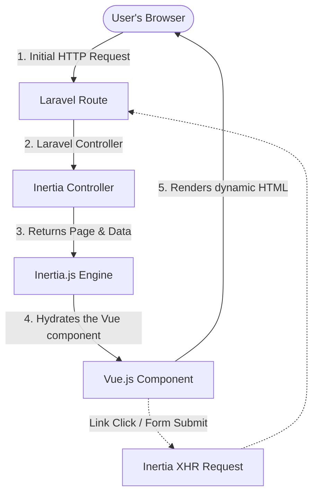

# 🏗️ Project Architecture

This document presents the global architecture of the containerized **Laravel 13 & Vue 3** skeleton. It explains how the different technologies in the stack interact.

---

## 🛠️ Technology Stack

*   **Backend**:
    *   **Laravel 13**: PHP framework for business logic and API routing.
    *   **PHP 8.5**: Major PHP version installed on the Apache web server.
*   **Frontend**:
    *   **Vue.js 3**: JavaScript framework for building dynamic user interfaces.
    *   **Inertia.js**: Seamless bridge connecting Laravel and Vue without having to build a complex REST/GraphQL API.
    *   **Vite**: Ultra-fast asset builder.
    *   **Tailwind CSS**: Utility-first CSS framework for rapid styling.
*   **Database**:
    *   **MySQL 8.4**: Relational database management system.
*   **Infrastructure (Docker)**:
    *   **Apache**: Web server built into the PHP image.
    *   **phpMyAdmin**: Graphical web interface for database administration.

---

## 🔗 Global Workflow (The Request Flow)

This project uses **Inertia.js**. Here is how a request works:



1. **No complex APIs**: Laravel controllers return responses using `Inertia::render('ComponentName', $data)`.
2. **Fluid SPA behavior**: Subsequent page loads are handled via automatic XHR requests managed by Inertia. Only JSON data is transferred, avoiding full-page reloads.

---

## 📂 Folder Structure

The project is split into two main sections: the Docker infrastructure configuration at the root and the application source code inside the `src/` directory.

```text
skeleton-laravel_vue/
├── compose.yml                # Docker Compose configuration
├── .env.example               # Root environment variables for Docker
├── docker/                    # Docker service configuration files
│   ├── mysql/
│   │   └── init.sql           # Database initialization script
│   └── php/
│       ├── Dockerfile         # Blueprint to build the PHP/Apache image
│       └── entrypoint.sh      # Script run when starting the container
└── src/                       # Application source code (Laravel + Vue.js)
    ├── app/                   # Backend PHP code (Controllers, Models, etc.)
    ├── bootstrap/             # Laravel bootstrapper files
    ├── config/                # Laravel configuration files
    ├── database/              # SQL migrations, factories, and seeders
    ├── public/                # Public folder (index.php, compiled assets)
    ├── resources/             # Frontend source assets (CSS, JS, Views)
    │   ├── css/
    │   │   └── app.css        # Main CSS file with Tailwind directives
    │   ├── js/
    │   │   ├── Components/    # Reusable Vue components (Buttons, Inputs...)
    │   │   ├── Layouts/       # Reusable page structures (Header, Nav...)
    │   │   ├── Pages/         # Application pages mapped to Inertia routes
    │   │   ├── app.js         # Inertia/Vue application entry point
    │   │   └── bootstrap.js   # Axios configuration for HTTP requests
    │   └── views/
    │       └── app.blade.php  # Base HTML template loaded by Inertia
    ├── routes/                # Route definition files (web.php, api.php)
    ├── package.json           # Node.js dependencies (Vue, Tailwind, Vite)
    ├── tailwind.config.js     # Tailwind CSS configuration
    └── vite.config.js         # Vite compilation configuration
```

---

## 🧭 Navigation

| 🏠 [Back to Homepage](../../README.md) | [Installation Guide (Step 2) ➡️](2-installation.md) |
