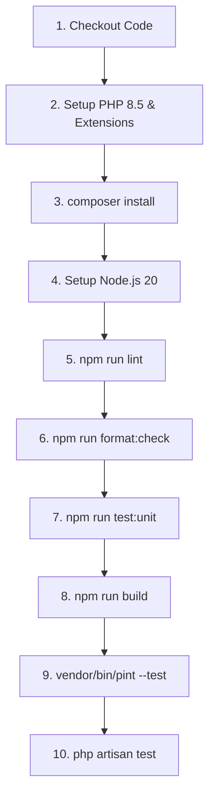

# 🚀 Continuous Integration (CI/CD)

## 🏗️ Pipeline Architecture

To resolve cross-dependencies (such as compiling Ziggy, which depends on the backend directory), the pipeline executes **sequentially** in a single job on an `ubuntu-latest` environment:



---

## 🛠️ Detailed Workflow Steps

The workflow is configured in the file [`.github/workflows/ci.yml`](../../.github/workflows/ci.yml):

### 1. PHP Backend Initialization
- **Version**: PHP 8.5 (with required extensions: `sqlite`, `pdo_sqlite`, `mbstring`, `zip`, etc.).
- **Caching**: Composer dependencies are cached to speed up future runs.
- **Dependencies**: Runs `composer install --prefer-dist --no-progress`.
- **Key Generation**: Automatically initializes the application key via `php artisan key:generate`.

### 2. Node.js Frontend Initialization & Build
- **Version**: Node.js 20 with npm caching.
- **Dependencies**: Strict installation via `npm ci`.
- **Style & Formatting (ESLint & Prettier)**: Runs `npm run lint` for static analysis and `npm run format:check` to check frontend formatting.
- **Unit Tests (Vitest)**: Runs `npm run test:unit` with the environment variable `LARAVEL_BYPASS_ENV_CHECK: 1` to prevent the CI security block.
- **Production Build**: Compiles assets via `npm run build`. This generates the `manifest.json` file required by Inertia.js.

### 3. Backend Quality Control & Tests
- **PHP Formatting (Laravel Pint)**: Runs `vendor/bin/pint --test`. This linter checks that code style rules (PSR-12/Laravel) are respected.
- **Laravel Tests (PHPUnit)**: Runs `php artisan test`. Tests are executed in an SQLite in-memory database (`:memory:`) for maximum performance.

---

## 💡 Troubleshooting Common CI Failures

### 1. Code Style Failure (Laravel Pint)
If the pipeline fails during the `Laravel Pint` step, it means some PHP files do not respect the standard formatting.
*   **Automatic Correction**: From your host machine (or inside your Docker container), execute the following command to automatically fix all files:
    ```bash
    docker exec -it laravel_app php vendor/bin/pint
    ```
*   Then, commit and push the corrections.

### 2. Frontend Linter or Style Failure (ESLint / Prettier)
If the pipeline fails during the ESLint check or Prettier formatting check, it means frontend files do not respect the defined rules.
*   **Automatic Correction**: From your host machine or inside the Docker container, run:
    ```bash
    # Fix JS/Vue syntax/style errors
    docker exec -it laravel_app npm run lint
    
    # Format all files (JS, Vue, CSS, JSON, MD)
    docker exec -it laravel_app npm run format
    ```
*   Then, commit and push the corrections.

### 3. Missing Import in Production
If the build fails due to a missing PHP import in your JS code (e.g., Ziggy), make sure `composer install` is run before Vite is called.

---

## 🧭 Navigation

| ⬅️ [Automated Tests (Step 6)](6-tests.md) | 🏠 [Back to Home](../../README.md) | [Code Quality (Step 8) ➡️](8-code-quality.md) |
