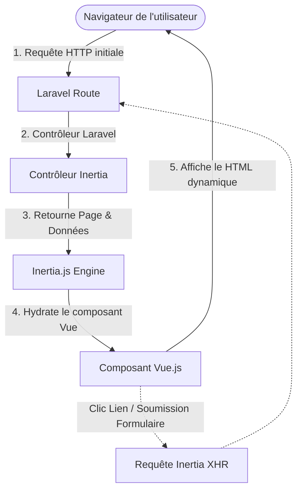

# 🏗️ Architecture du Projet

Le document présente l'architecture globale du skeleton **Laravel 13 & Vue 3** conteneurisé. Il explique comment les différentes techno de la stack interagissent.

---

## 🛠️ Stack Technologique

*   **Backend** :
    *   **Laravel 13** : Framework PHP pour la logique métier et l'API.
    *   **PHP 8.5** : Version majeure de PHP installée sur le serveur Apache.
*   **Frontend** :
    *   **Vue.js 3** : Framework JavaScript pour la création d'interfaces dynamiques.
    *   **Inertia.js** : Liaison transparente entre Laravel et Vue sans avoir à construire d'API REST/GraphQL.
    *   **Vite** : Outil de build ultra-rapide.
    *   **Tailwind CSS** : Framework CSS utilitaire pour concevoir rapidement des interfaces.
*   **Base de Données** :
    *   **MySQL 8.4** : Système de gestion de base de données relationnelle.
*   **Infrastructure (Docker)** :
    *   **Apache** : Serveur web intégré à l'image PHP.
    *   **phpMyAdmin** : Interface web d'administration de la base de données.

---

## 🔗 Fonctionnement Global (Le Flux)

Le projet utilise **Inertia.js**. Voici comment se déroule une requête :



1. **Pas d'API complexe** : Les contrôleurs Laravel retournent des réponses via `Inertia::render('NomDuComposant', $donnees)`.
2. **Fluidité d'une SPA** : Les chargements de pages suivants se font par requêtes XHR automatiques gérées par Inertia. Seules les données JSON sont transférées, ce qui évite le rechargement complet de la page web.

---

## 📂 Structure des Répertoires

Le projet est divisé en deux parties principales : la configuration de l'infrastructure Docker à la racine et le code de l'application dans le dossier `src`.

```text
skeleton-laravel_vue/
├── compose.yml                # Configuration Docker Compose
├── .env.example               # Variables d'environnement pour Docker
├── docker/                    # Fichiers de configuration des services Docker
│   ├── mysql/
│   │   └── init.sql           # Script d'initialisation de la BDD
│   └── php/
│       ├── Dockerfile         # Recette pour construire l'image PHP/Apache
│       └── entrypoint.sh      # Script exécuté au démarrage du conteneur
└── src/                       # Code source de l'application Laravel + Vue.js
    ├── app/                   # Code PHP backend (Contrôleurs, Modèles, etc.)
    ├── bootstrap/             # Fichiers d'initialisation de Laravel
    ├── config/                # Fichiers de configuration de Laravel
    ├── database/              # Migrations, Factories et Seeders SQL
    ├── public/                # Répertoire public (index.php, fichiers compilés)
    ├── resources/             # Fichiers sources frontend (CSS, JS, Vues)
    │   ├── css/
    │   │   └── app.css        # Fichier CSS principal avec directives Tailwind
    │   ├── js/
    │   │   ├── Components/    # Composants Vue réutilisables (Boutons, Inputs...)
    │   │   ├── Layouts/       # Structures de page réutilisables (Header, Nav...)
    │   │   ├── Pages/         # Pages de l'application liées aux routes Inertia
    │   │   ├── app.js         # Point d'entrée de l'application Inertia/Vue
    │   │   └── bootstrap.js   # Configuration d'Axios pour les requêtes HTTP
    │   └── views/
    │       └── app.blade.php  # Template HTML de base chargé par Inertia
    ├── routes/                # Fichiers de définition des routes (web.php, api.php)
    ├── tests/                 # Suite de tests automatisés (PHPUnit et Vitest)
    │   ├── Feature/           # Tests fonctionnels PHP (Laravel)
    │   ├── Unit/              # Tests unitaires PHP (Laravel)
    │   └── Frontend/          # Tests unitaires & composants JS (Vue 3)
    ├── package.json           # Dépendances Node.js (Vue, Tailwind, Vite)
    ├── tailwind.config.js     # Configuration de Tailwind CSS
    ├── vitest.config.js       # Configuration de Vitest
    └── vite.config.js         # Configuration du compilateur Vite
```

---

## 🧭 Navigation

| 🏠 [Retour à l'Accueil](../../README.fr.md) | [Guide d'Installation (Étape 2) ➡️](2-installation.md) |
