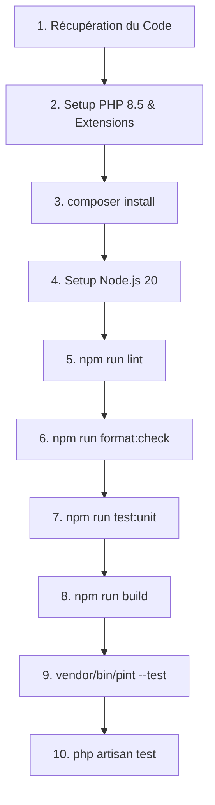

# 🚀 Intégration Continue (CI/CD)

## 🏗️ Architecture du Pipeline

Pour résoudre les dépendances croisées (comme la compilation de Ziggy qui dépend du répertoire backend), le pipeline s'exécute de manière **séquentielle** dans un job unique sur un environnement `ubuntu-latest` :



---

## 🛠️ Étapes Détaillées du Workflow

Le workflow est configuré dans le fichier [`.github/workflows/ci.yml`](../../.github/workflows/ci.yml) :

### 1. Initialisation Backend PHP
- **Version** : PHP 8.5 (avec extensions requises : `sqlite`, `pdo_sqlite`, `mbstring`, `zip`, etc.).
- **Mise en cache** : Les dépendances Composer sont mises en cache pour accélérer les exécutions futures.
- **Dépendances** : Lancement de `composer install --prefer-dist --no-progress`.
- **Génération de clé** : Initialisation automatique de la clé applicative via `php artisan key:generate`.

### 2. Initialisation & Build Frontend (Node.js)
- **Version** : Node.js 20 avec mise en cache npm.
- **Dépendances** : Installation stricte via `npm ci`.
- **Style & Formate (ESLint & Prettier)** : Exécution de `npm run lint` pour l'analyse statique et `npm run format:check` pour vérifier le formatage de tous les fichiers frontend.
- **Tests unitaires (Vitest)** : Exécution de `npm run test:unit` avec la variable d'environnement `LARAVEL_BYPASS_ENV_CHECK: 1` pour éviter le blocage de sécurité en CI.
- **Build de Production** : Compilation des assets via `npm run build`. Cette étape génère le fichier `manifest.json` requis par Inertia.js.

### 3. Contrôle Qualité & Tests Backend
- **Formatage PHP (Laravel Pint)** : Exécution de `vendor/bin/pint --test`. Ce linter vérifie que les règles de style de code (PSR-12/Laravel) sont respectées.
- **Tests Laravel (PHPUnit)** : Lancement de `php artisan test`. Les tests s'exécutent en mémoire SQLite (`:memory:`) pour des performances maximales.

---

## 💡 Résoudre les échecs courants en CI

### 1. Échec de style de code (Laravel Pint)
Si le pipeline échoue à l'étape `Laravel Pint`, cela signifie que des fichiers PHP ne respectent pas le formatage standard.
*   **Correction automatique** : Depuis votre machine (ou dans votre conteneur Docker), exécutez la commande suivante pour corriger automatiquement tous les fichiers :
    ```bash
    docker exec -it laravel_app php vendor/bin/pint
    ```
*   Puis, commitez et poussez les corrections.

### 2. Échec de style ou linter frontend (ESLint / Prettier)
Si le pipeline échoue à l'étape de linter JS/Vue ou de vérification Prettier, c'est que des fichiers du frontend ne respectent pas les conventions définies.
*   **Correction automatique** : Depuis votre machine ou votre conteneur, exécutez :
    ```bash
    # Corriger les erreurs de syntaxe/style JS/Vue
    docker exec -it laravel_app npm run lint
    
    # Formater tous les fichiers (JS, Vue, CSS, JSON, MD)
    docker exec -it laravel_app npm run format
    ```
*   Puis, commitez et poussez les corrections.

### 3. Erreur d'import manquant en production
Si le build échoue à cause d'un import de fichier PHP manquant dans votre code JS (ex: Ziggy), assurez-vous que `composer install` est bien exécuté avant d'appeler Vite.

---

## 🧭 Navigation

| ⬅️ [Tests Automatisés (Étape 6)](6-tests.md) | 🏠 [Retour à l'Accueil](../../README.fr.md) | [Qualité de Code (Étape 8) ➡️](8-code-quality.md) |
